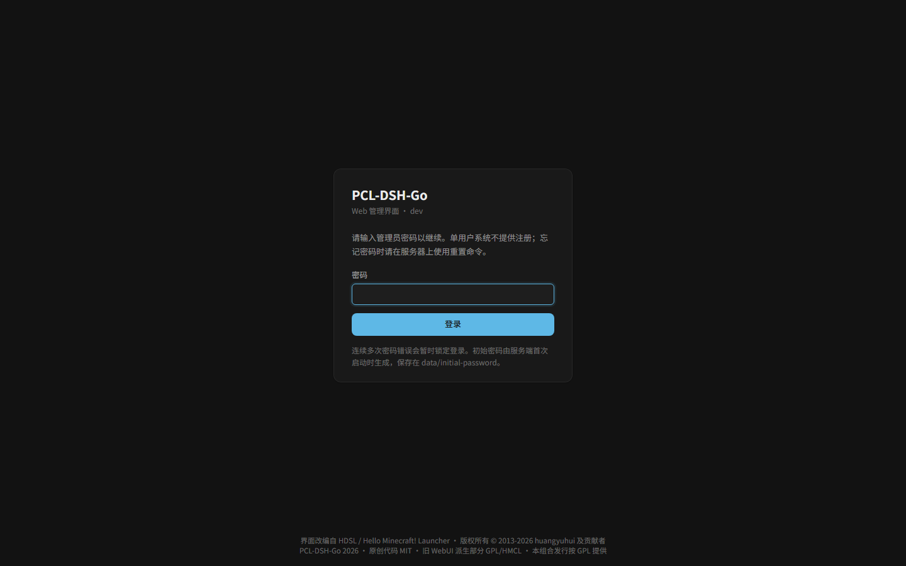
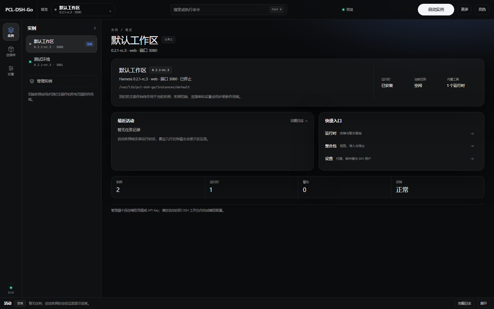

# PCL-DSH-Go

**在 Linux 服务器上用 WebUI 管理 DeepSeek Harness（DSH）实例**的开源管理器：Go 单二进制、内置 Node/pnpm、自带 Web 管理界面，配合 Nginx 即可完成安装、运行时下载、实例启停、工作台访问与插件管理。

当前版本 **0.2.1**（本项目的独立版本号；与 DSH 运行时的 `0.2.1-rc.3` 等版本号互不绑定，仅表示已验证的 DSH 基线，见 [docs/CHANGELOG.md](docs/CHANGELOG.md)）。



## 功能

- **实例管理**：创建/编辑/选择/删除实例，启动/停止，自动端口分配，按精确 DSH 版本与 profile 创建；支持同时运行多个实例（并发上限可配置，默认不限制）。
- **运行时管理**：从 npm registry 查询可用 DSH 版本、安装到本地 `runtimes/`、能力探测、删除引用保护；安装与探测以任务进度（Job + SSE）展示。
- **工作台反代**：`/workbench/{id}/` 反向代理 DSH WebUI，支持 HTTP、SSE、WebSocket，处理 token 引导、Cookie/Location/Origin 重写与登录门槛。
- **直连登录**：运行中的实例可生成 SSH 隧道命令 + 一次性 token URL，SSH 用户可在设置中配置。
- **整合包**：`.dspack`（v2/v3）与 Overture snapshot 的预览、导入（生成实例）、导出（下载 artifact），全程走安全归档校验。
- **已装插件**：按实例 profile 列出/安装/更新/移除插件，内置 bundle 受保护，操作以任务进度展示。
- **任务与日志**：最近任务列表、任务详情、SSE 实时进度与取消；管理器日志查看（默认 tail 800 行，自动脱敏）。
- **设置**：npm registry、HTTP 代理、直连登录 SSH 用户。
- **部署友好**：提供 Linux release（内置 Node 24.22.1 + pnpm 11.28.5）、systemd unit、Nginx site 模板、install/uninstall/reset 脚本与 SHA256 校验；服务器无需系统 Node/npm/JDK。



## 典型使用流程

1. 安装并启动管理器（见下方「快速开始」）。
2. 浏览器打开 `http://localhost/`，用首次启动生成的初始密码登录，并按提示修改密码。
3. 「下载」页选择并安装一个 DSH 运行时版本（例如 `0.2.1-rc.3`）。
4. 「实例」页创建实例（版本 + profile），点击「启动」；就绪后「打开 Web」进入工作台。
5. 按需使用整合包导入/导出、插件管理、任务日志与设置；多实例可同时运行（见 [docs/USER_GUIDE.md](docs/USER_GUIDE.md)）。

## 快速开始（Linux 服务器 / WSL）

> 需要 Linux x86_64、systemd、Nginx（生产部署）。管理器只监听 `127.0.0.1:8080`，对外统一由 Nginx 提供服务。

```bash
# 1. 下载并校验 release（以 0.2.1 为例；文件名中的版本号以实际 release 为准）
sha256sum -c pcl-dsh-go-0.2.1-linux-amd64.tar.gz.sha256
tar -xzf pcl-dsh-go-0.2.1-linux-amd64.tar.gz
cd pcl-dsh-go-0.2.1-linux-amd64
sha256sum -c SHA256SUMS

# 2. 安装（root）：创建 pcl-dsh 用户、/opt/pcl-dsh-go、systemd 与 Nginx site
sudo ./packaging/install.sh
# 2C / 1.6 GiB 机器建议显式限制同时运行实例数（默认 0 = 不限制）：
# sudo ./packaging/install.sh --max-running-instances 1

# 3. 浏览器访问 http://localhost/，初始密码：
sudo cat /var/lib/pcl-dsh-go/initial-password
```

首次登录会强制修改密码，随后按「下载 → 实例 → 启动 → 打开 Web」流程使用。完整的安装、升级、回滚、卸载与排障见 [docs/DEPLOYMENT.md](docs/DEPLOYMENT.md)。

> **WSL 提示**：管理器应运行在 WSL/Linux 中，Windows 浏览器通过 `http://localhost/` 访问；不要在 Windows 上直接运行管理器进程。WSL 需要启用 systemd（`/etc/wsl.conf` 中 `[boot] systemd=true`）。

## 配置摘要

| 参数 | 默认值 | 说明 |
| --- | --- | --- |
| `--server.address` | `127.0.0.1` | 管理器监听地址（仅回环，公网入口交给 Nginx） |
| `--server.port` | `8080` | 管理器监听端口 |
| `--server.static-dir` | 空 | WebUI 构建产物目录；空时使用内置占位页（生产由 Nginx 提供静态资源） |
| `--pcl.data-root` | `./data` | 数据目录（也可用环境变量 `PCL_DSH_DATA`） |
| `--pcl.tool-root` | 空 | 内置 Node/pnpm 的 tools 目录（空表示自动查找） |
| `--pcl.max-running-instances` | `0`（不限制） | 同时运行的 DSH 实例上限；`0` 不限制，2C/1.6 GiB 建议显式设为 `1` |
| `--pcl.dev-mode` | `false` | 调试接口开关，仅开发/测试使用 |

完整参数、环境变量、数据目录与端口说明见 [docs/CONFIGURATION.md](docs/CONFIGURATION.md)。

## 安全模型

- **单管理员**：不提供账户系统；管理员密码使用 BCrypt（cost 10）保存，首次启动生成 24 位初始密码（`initial-password` 0600），首次登录强制修改。
- **会话与请求防护**：服务端会话 Cookie（12 小时滑动过期）+ CSRF 双提交校验；登录失败按 IP 限流；首登未改密时除认证/健康检查外全部返回 `403`。
- **最小暴露面**：管理器默认只监听 `127.0.0.1`；systemd unit 使用 `NoNewPrivileges/ProtectSystem=strict` 等沙箱；Nginx 对敏感路径关闭 access log。
- **敏感数据**：日志/审计自动脱敏，token、密码、Cookie、一次性 URL 不写入日志；数据目录 0700、凭据文件 0600。
- **不可信输入**：整合包走白名单式安全归档校验；代理仅允许回环上游；插件/运行时安装会执行第三方代码，请只使用可信来源。

漏洞报告流程与加固建议见 [SECURITY.md](SECURITY.md)。

## 文档

- [文档索引](docs/README.md)
- [用户指南（WebUI 全流程）](docs/USER_GUIDE.md)
- [部署与运维](docs/DEPLOYMENT.md)
- [配置参考](docs/CONFIGURATION.md)
- [架构说明](docs/ARCHITECTURE.md)
- [开发与发布](docs/DEVELOPMENT.md)
- [更新日志](docs/CHANGELOG.md)
- [贡献指南](CONTRIBUTING.md) · [安全策略](SECURITY.md)
- 历史设计与验收资料（开发期归档）：[docs/dev/README.md](docs/dev/README.md)

## 兼容性与边界

- 目标平台：**Linux x86_64**（生产建议独立 Linux 主机；WSL2 可用于本机部署/验收）。Windows 仅用于浏览器访问与前端构建，不支持在 Windows 上运行管理器。
- 已验证 DSH 基线：`0.2.1-rc.3`；其他版本以 npm registry 实际可用为准，并在安装/探测时校验。
- 应用层只提供 HTTP；HTTPS 由 Nginx 或前置代理终止。
- 不包含：多用户/账户系统、API Key/Provider 管理、社区插件目录、背景图管理、旧版本数据迁移、ARM64。

## 路线图与待办（Roadmap / TODO）

以下为后续不破坏兼容性的改进方向（非时间承诺；欢迎在 Issue 中讨论或认领）：

- **简化部署流程**：收敛一键安装/升级/回滚体验，减少手工 Nginx/systemd 配置与前置检查，提供交互式安装与更清晰的失败恢复路径。
- **版本号单一化**：以仓库根 `VERSION` 为唯一事实源，构建、CI、release 与验收脚本统一读取，消除当前分散在多处的硬编码版本字符串。
- **减少硬编码常量**：端口、路径、默认值、registry/镜像地址等收敛为集中配置与常量表，便于不同环境定制。
- **前端彻底重构**：整理组件/状态/API 分层与类型定义，降低耦合，补齐单元/组件测试与可访问性支持。
- **工作台旧 Cookie 自动恢复**：检测到 DSH 上游鉴权失败时自动清理旧 `dsh-auth-*` Cookie 并走 token 引导（当前需手动清 Cookie，见 [CHANGELOG](docs/CHANGELOG.md) 的 Known issues）。

## 许可与致谢

本项目以 **GPL-3.0-or-later** 发布，并包含 HMCL 第 7 条附加条款；完整文本见 [LICENSE](LICENSE)、[LICENSES/](LICENSES/) 与 [THIRD_PARTY_NOTICES.md](THIRD_PARTY_NOTICES.md)。

界面与交互设计复用/改编自 [PCL-DSH-Linux](https://github.com/LeuJasYoh/pcl-dsh-linux) / HDSL（Hello Minecraft! Launcher 生态）项目，相关版权与许可声明按原项目保留。DeepSeek Harness（DSH）为 DeepSeek 的项目；本项目与 DeepSeek 官方无隶属关系。感谢 Go、Vue、Vite、Nginx 等开源项目。
