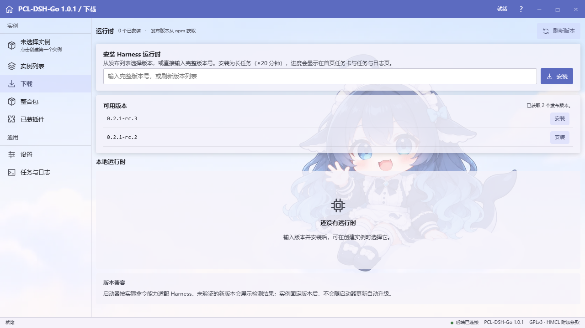
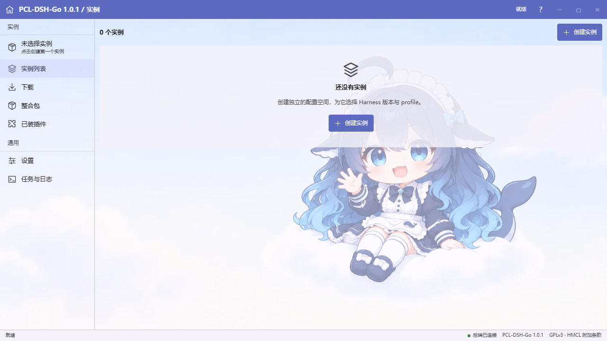
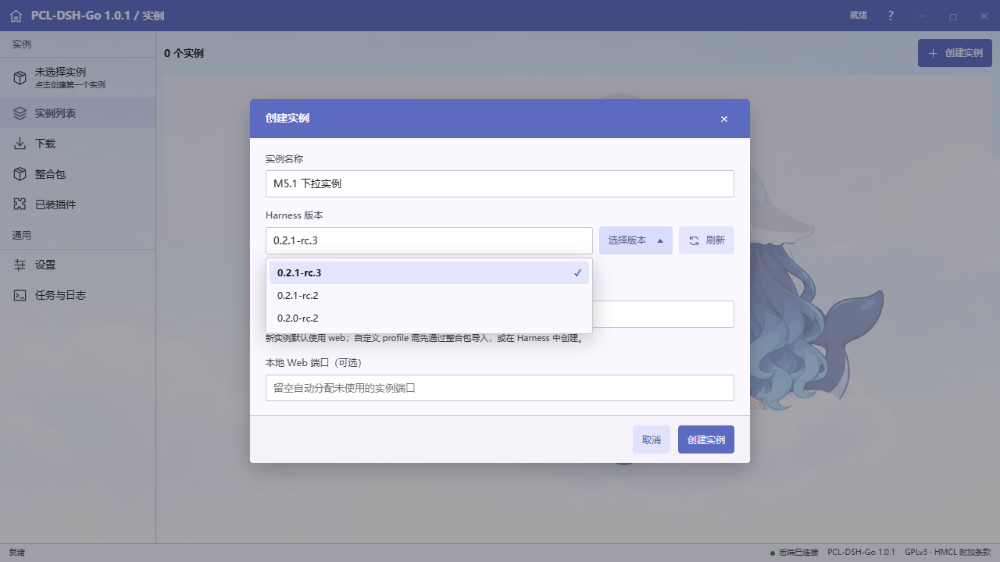
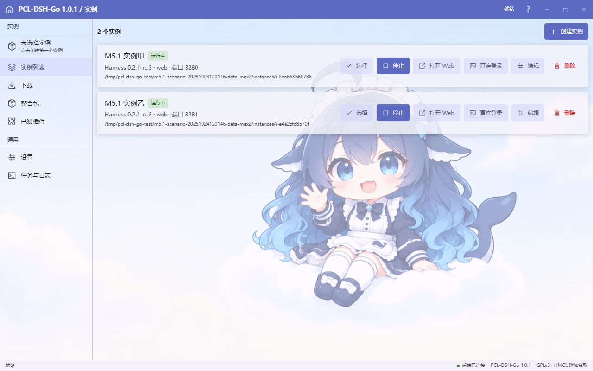
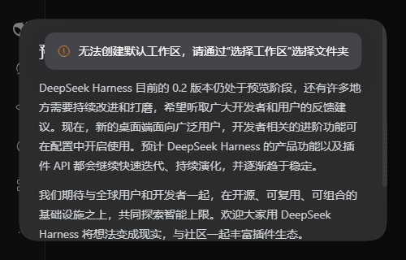
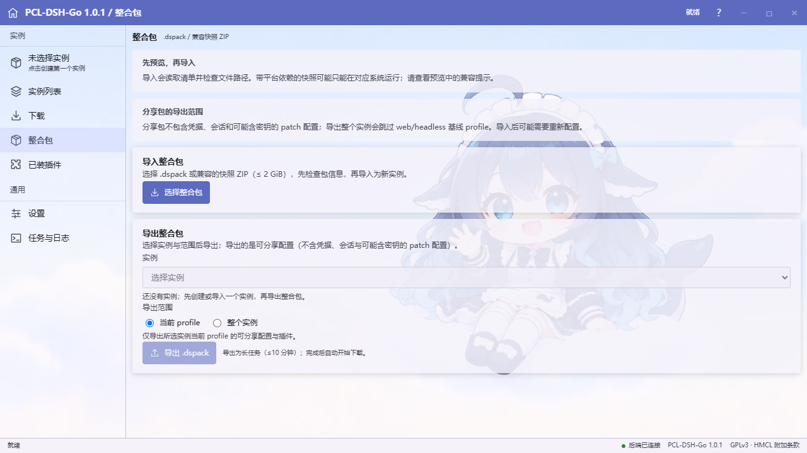
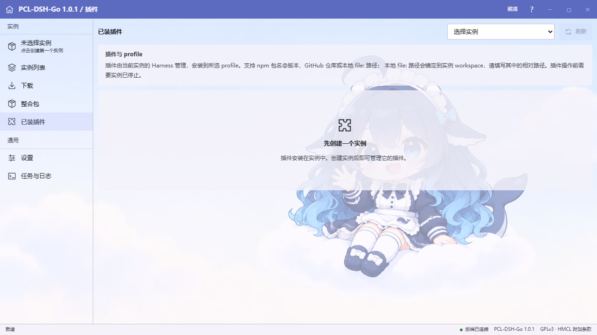
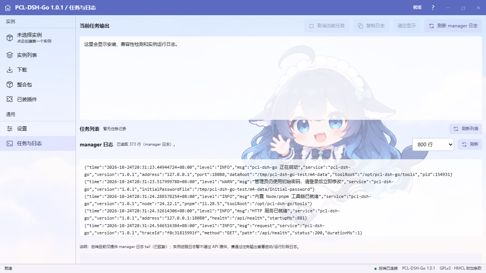
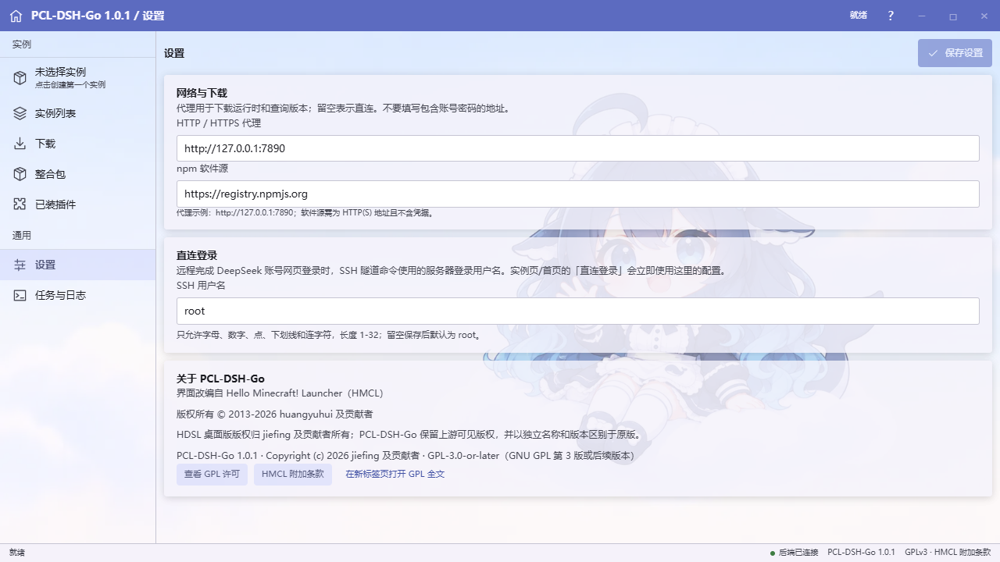

# 用户指南

> 对应当前源码与 **0.2.3** 发行包，版本见 [`VERSION`](../VERSION)，变更见 [CHANGELOG](CHANGELOG.md)。截图保留 0.2.1 发行时的界面，0.2.2 起的顶部栏和部分输入规则已调整；旧发行包以随包文档为准。

本文介绍 PCL-DSH-Go WebUI 的完整使用流程。安装与系统运维见 [部署与运维](DEPLOYMENT.md)，参数与数据布局见 [配置参考](CONFIGURATION.md)。

## 1. 登录与密码

1. 首次启动管理器后，管理员初始密码保存在服务器上的 `<data-root>/initial-password`（默认 `/var/lib/pcl-dsh-go/initial-password`，权限 0600，root 可读）。
2. 浏览器打开 `http://localhost/`（或部署时配置的地址），输入初始密码登录。
3. **首次登录必须修改密码**（8–256 个 Unicode 码点，不含控制字符，不能与旧密码相同）；修改成功后 `initial-password` 会被删除，下次使用新密码登录。
4. 服务端持久化加盐哈希，不保存修改后的明文密码；首次生成的 `initial-password` 是交付初始密码的临时例外，改密后删除。
5. 连续多次密码错误会按来源 IP 临时锁定，稍后再试；登录成功后会话默认 12 小时滑动过期。

> 忘记密码：单管理员系统没有“找回”流程。请使用服务器上的重置命令（会清空数据，见 [部署与运维 · 重置数据](DEPLOYMENT.md#11-重置数据危险)），或从备份恢复数据目录。重置密码前请先确认是否需要保留现有实例数据。

## 2. 界面结构

登录后左侧导航（桌面端）：

| 导航 | 用途 |
| --- | --- |
| **启动** | 首页：启动当前选中实例、查看最近任务、创建实例入口 |
| **实例** | 实例列表：选择/编辑/删除/启动/停止/打开 Web/直连登录 |
| **下载** | DSH 运行时版本管理：查询、安装、探测、删除 |
| **整合包** | dspack / Overture 预览、导入、导出与下载 |
| **已装插件** | 按实例 profile 管理插件（安装/更新/移除） |
| **设置** | npm registry、HTTP 代理、直连登录 SSH 用户 |
| **任务与日志** | 任务列表、任务详情/进度/取消、管理器日志 |

顶部显示产品名称、后端返回的项目版本和任务状态文字；已移除鲸鱼图标、问号及仿桌面最小化/最大化/关闭按钮。子页保留返回启动页的入口，关于与许可从「设置」访问；底部状态栏仍显示连接状态与当前版本。

## 3. 安装 DSH 运行时

首次使用先准备运行时（DSH 的 npm 包版本）：

1. 打开「下载」页，点击刷新/查询可用版本（从「设置」中的 npm registry 获取）。
2. 在版本下拉中选择一个精确版本（例如 `0.2.1-rc.3`），点击安装。
3. 安装以任务形式执行：页面可查看阶段与实时日志（SSE），失败会显示错误原因；安装期间可继续其它只读操作，写操作会因“忙”返回 `409`。
4. 安装完成后运行时出现在已安装列表；可执行“探测”验证能力，或删除（被实例引用时删除会被拒绝）。

> 运行时安装在 `<data-root>/runtimes/<版本>`，由内置 pnpm 从 registry 下载；首次安装约 500 MB，请确保磁盘空间与网络可达。已在其它实例中使用/已验证的同一版本会复用。

## 4. 创建与管理实例

1. 「实例」页点击「创建实例」。
2. 填写名称（1–160 字符），选择完整 SemVer 的 DSH 版本与 profile（默认 `web`，规则见下）；端口留空自动分配（3080 起），手动填写范围为 1024–65535。
3. 创建后实例出现在列表；**版本与 profile 创建后不可修改**（修改请删除重建），名称和端口可编辑。
4. 列表操作：
   - **选择**：把实例设为当前实例（首页「启动」使用它）；
   - **启动/停止**：启动会探测运行时能力、拉起 DSH 进程并等待就绪（任务进度可见）；停止会结束该实例进程树并释放端口；
   - **打开 Web**：新窗口打开 `/workbench/{id}/`（需实例运行且就绪）；
   - **直连登录**：见第 6 节；
   - **编辑/删除**：删除会移入回收站（`trash/`），运行中的实例需先停止。

创建时的版本选择器支持下拉选择与手动输入精确 SemVer（修复了旧版下拉不展开的问题）：

### Profile 是什么

Profile 是 DSH 的一套命名运行配置，决定加载哪些功能和插件，不是账户或实例显示名称；位于实例的 `dsh-home/profiles/<profile>/` 下。一般使用默认 `web`；自定义 profile 需要先准备相应 DSH 配置或通过整合包导入，填写新名字不会自动复制 `web` 模板。

- 支持 Unicode 字母/数字（含中文）、普通内部空格、点、下划线和连字符，首字符必须为字母或数字。
- 最多 64 个 Unicode 码点；禁止首尾空白、控制字符、`/`、`\`、连续点 `..` 和结尾点。
- 拒绝 `node_modules`、Windows 设备保留名（如 `CON`、`AUX`、`COM1`）及其带扩展名形式，不区分大小写。
- 合法示例：`web`、`my-profile`、`中文 配置`；非法示例：`../web`、`a..b`、`CON`。

## 5. 多实例同时运行

- 管理器支持同时运行多个 DSH 实例；**默认不限制并发数**（`--pcl.max-running-instances=0`）。每个实例使用独立端口与目录。
- 每个 DSH 实例的 Node 进程常驻约 300–400 MiB，另加管理器与系统开销。资源有限的机器（如 2 vCPU / 1.6 GiB）建议显式限制为 1：`--pcl.max-running-instances=1`（部署参数见 [DEPLOYMENT.md](DEPLOYMENT.md)）。
- 达到上限后启动会返回 `409 CONFLICT_RUNNING_INSTANCE`，提示“当前最多允许同时运行 N 个 DSH 实例”，请先停止其它实例。
- 多实例同时运行示例：

## 6. 工作台（/workbench）

实例就绪后点击「打开 Web」，浏览器进入管理器的反向代理路径 `/workbench/{id}/`，其背后是该实例的 DSH WebUI：

- 未登录管理器时访问工作台会被拒绝（需先登录 WebUI）；
- 管理器负责 DSH 的一次性 token 引导、Cookie/Location/Origin 重写，以及 HTTP/SSE/WebSocket 透传；
- 工作台内登录、会话、插件界面均由 DSH 自身管理，管理器不保存 DSH 凭据。
- 默认工作区位于当前实例的 `workspace/deepseek-harness/default-workspace`；「添加工作区」的目录选择器从该实例的 `workspace` 打开。编辑路径时按钮会暂时置灰，先按 Enter 提交路径，再新建文件夹或打开目录。
- 默认 systemd 沙箱只允许写管理器 data-root，不会向 DSH 开放 `/root`、`/home` 或发行目录的写权限；请在实例工作区内创建目录，或由运维人员明确配置额外目录及权限。

> **已知问题（工作台旧 Cookie）**：升级管理器或切换实例后，浏览器可能残留上一个工作台的 DSH Cookie，出现要求重新登录、空白或 `401/403`。处理：清除该站点的 Cookie（或使用无痕窗口）后重新打开工作台。后续版本将按实例隔离工作台 Cookie。

## 7. 直连登录（SSH 隧道 + 一次性 URL）

适合通过 SSH 隧道直接打开工作台（例如公网服务器只开放 SSH）：

1. 在「设置」中配置「直连登录 SSH 用户」（默认 `root`，只允许字母/数字/点/下划线/连字符，1–32 位）。
2. 实例运行且就绪后，在实例列表点击「直连登录」。
3. 对话框显示：
   - **SSH 隧道命令**，形如 `ssh -L 3080:127.0.0.1:3080 <sshUser>@<服务器地址>`；
   - **一次性 URL**，形如 `http://127.0.0.1:3080/?token=...`（仅在本机隧道建立后有效，请勿分享）；
   - 未就绪时提示先启动实例。
4. 在本机终端执行隧道命令，然后在浏览器打开一次性 URL 即可进入工作台。token 有有效期，失效后重新打开对话框获取。

复制按钮在 HTTP 或浏览器禁止 Clipboard API 时会尝试兼容复制；若仍被浏览器拒绝，对话框会显示并选中手动复制文本，按 Ctrl+C 或长按复制即可。

## 8. 整合包

「整合包」页支持 PCL-DSH 生态的整合包（`.dspack` v2/v3、Overture snapshot v1）：

1. **预览**：上传压缩包后异步解析，显示名称/版本/DSH 版本/profiles/解包大小/告警；恶意或超限归档会被拒绝（安全规则见 [ARCHITECTURE.md](ARCHITECTURE.md#5-安全模型)）。
2. **导入**：选择已预览的包，作为新实例导入（任务执行，可查看进度/日志）；失败会回滚，不污染现有实例。
3. **导出**：对已有实例导出 profile 或 home 为整合包（任务执行），完成后在任务/下载处获取 artifact（默认 24 小时有效）。

> 上传大小上限约 2 GiB；导入会校验包内路径、大小、压缩比、链接和清单结构，非法包不会被解包到数据目录之外；使用者仍需自行确认包内内容的授权。

## 9. 已装插件

在「已装插件」页选择实例 profile，可查看该 profile 的插件列表（名称/版本/说明/来源），并进行：

- **安装**：输入 npm 包名/版本 spec；
- **更新**：修改已安装插件的版本；
- **移除**：内置 bundle（`dsh.profile.bundles` 声明的核心插件）不允许移除；
- 变更由内置 pnpm/DSH CLI 执行，以任务形式展示进度与日志；安装/更新/移除前必须先停止实例，运行中的实例会拒绝这些写操作。

## 10. 任务与日志

- 「任务与日志」页展示最近任务（安装运行时、启动实例、导入/导出整合包、插件变更等），可查看阶段、进度、实时日志（SSE）、取消任务；任务列表最多保留最近 20 条。
- 页面同时提供**管理器日志** tail（默认 800 行，最大 2000），日志已自动脱敏（token/密码/Cookie 等不会出现）。
- 错误处理：同步校验错误直接以中文提示返回；进入任务后的失败显示在任务详情中，并保留可操作信息。

## 11. 设置

| 设置 | 说明 |
| --- | --- |
| npm registry | 运行时/插件安装使用的 npm registry；必须是 `http(s)` 地址，不允许带用户名密码 |
| HTTP 代理 | 访问 npm registry 等外网时使用的代理；格式 `http://host:port`，不允许带用户信息 |
| 直连登录 SSH 用户 | 直连登录命令中的用户名，默认 `root` |

修改保存即时生效（新任务使用新设置）；正在运行的任务不受影响。

## 12. 常见问题

**Q：登录后立刻被要求改密，正常吗？**
正常。首次登录必须修改管理员密码；改密后初始密码文件被删除。

**Q：忘记管理员密码？**
单管理员系统不支持找回；用服务器上的重置流程清空数据并重新生成初始密码（会丢失实例/运行时），或从备份恢复。见 [DEPLOYMENT.md](DEPLOYMENT.md#11-重置数据危险)。

**Q：启动实例失败？**
按提示排查：运行时未安装 → 先去「下载」安装；端口被占用 → 编辑实例换端口；达到并发上限 → 停止其它实例或调大 `--pcl.max-running-instances`；失败详情可在任务日志中查看。

**Q：实例一直“启动中”/未就绪？**
查看任务日志中的探测/启动输出；确认端口未被占用、内置工具链存在、磁盘空间充足。必要时停止后重试。

**Q：工作台打开空白或 401/403？**
先清除该站点旧 Cookie（或使用无痕窗口）；确认实例状态为“运行中/就绪”并重新打开。见第 6 节已知问题。

**Q：插件/运行时安装很慢或失败？**
检查服务器网络与「设置」中的 registry/代理；失败任务可重试。磁盘不足时清理旧运行时或 `cache/pnpm-store`。

**Q：如何备份数据？**
停止管理器后打包数据目录（至少 `config/` 与 `instances/`）；详见 [DEPLOYMENT.md](DEPLOYMENT.md#12-备份与恢复)。

**Q：日志里会有密码/token 吗？**
不会。管理器日志与审计日志写入前会脱敏；Nginx 对 API/工作台路径关闭访问日志。请勿在 issue/截图中粘贴真实凭据。

## 13. 相关文档

- [部署与运维](DEPLOYMENT.md)
- [配置参考](CONFIGURATION.md)
- [架构说明](ARCHITECTURE.md)
- [更新日志](CHANGELOG.md)
- [安全策略](../SECURITY.md)
